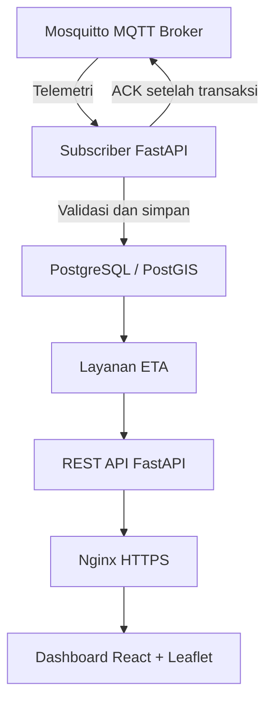

# Arsitektur Sistem PM-TRAVEL

## 1. Gambaran Umum

PM-TRAVEL merupakan sistem pelacakan kendaraan travel
dan estimasi waktu kedatangan berbasis data lokasi
dan Machine Learning.

Sistem menggunakan ESP32, GPS NEO-6M, dan SIM800L
untuk mengirimkan lokasi kendaraan melalui MQTT.

Seluruh layanan pusat direncanakan berjalan
pada satu VPS Biznet Gio.

## 2. Arsitektur Perangkat dan Komunikasi

Penjelasan:

1. GPS NEO-6M membaca posisi kendaraan.
2. ESP32 memproses data GPS dan membentuk telemetri.
3. SIM800L menyediakan koneksi data seluler.
4. Mosquitto menerima pesan MQTT dari perangkat.

Pengiriman GPS direncanakan setiap 10 detik.

## 3. Arsitektur Pemrosesan Data

Penjelasan:

1. Subscriber backend menerima pesan dari broker.
2. Backend memvalidasi identitas dan data GPS.
3. Data valid disimpan ke PostgreSQL/PostGIS.
4. ACK aplikasi dikirim setelah transaksi berhasil.
5. Layanan ETA menggunakan data posisi dan perjalanan.
6. FastAPI menyediakan data melalui REST API.
7. Nginx melayani frontend dan meneruskan permintaan API.
8. Dashboard menampilkan lokasi kendaraan dan ETA.

## 4. Infrastruktur VPS

Provider: Biznet Gio.

Paket yang direncanakan: NEO Lite MS 4.2.

Spesifikasi:
- 2 vCPU.
- RAM 4 GB.
- SSD 60 GB.
- Sistem operasi Linux.

Layanan:
- Mosquitto MQTT Broker.
- FastAPI Backend.
- PostgreSQL/PostGIS.
- Layanan ETA.
- Nginx.
- Frontend React + Leaflet.

Cloudflare Pages tidak digunakan.

## 5. Pemisahan Jalur Komunikasi

### 5.1 Jalur Telemetri

ESP32 → SIM800L → MQTT → Backend → Database.

### 5.2 Jalur ACK

Backend → MQTT → SIM800L → ESP32.

### 5.3 Jalur Dashboard

Browser → HTTPS Nginx → Frontend React.

### 5.4 Jalur API

Browser → HTTPS Nginx → FastAPI → Database/ETA.

## 6. Penanganan Gangguan

Jika jaringan GPRS terputus:
- ESP32 menampung pesan dalam buffer RAM.
- Perangkat mencoba melakukan koneksi ulang.
- Pesan dikirim ulang menggunakan identitas asli.
- Backend mencegah penyimpanan pesan duplikat.

Jika data GPS tidak valid:
- Backend mencatat status data.
- Posisi terakhir yang valid dipertahankan.
- ETA tidak dihitung menggunakan koordinat tidak valid.

## 7. Status Implementasi

- Pengiriman GPS melalui MQTT: sudah berhasil diuji.
- Kontrak data dan arsitektur: tahap dokumentasi.
- Broker Mosquitto final: belum diuji.
- Backend FastAPI: belum terverifikasi.
- PostgreSQL/PostGIS: belum terverifikasi.
- ETA: belum diimplementasikan.
- Frontend terintegrasi: belum diimplementasikan.
- VPS Biznet Gio: belum dibeli.