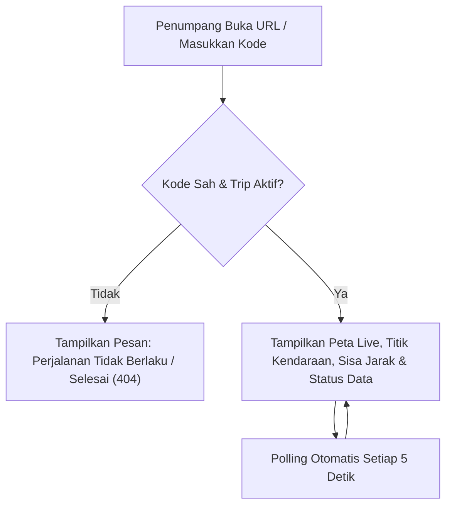

# PM_11 — Alur Pengguna, Rancangan Antarmuka, dan Status Dashboard

**Versi Dokumen:** 1.0  
**Tanggal:** 27 November 2026  
**PIC Perencanaan & Analisis Sistem:** Maulana Rizki Ramadhani  
**PIC Frontend & UI/UX:** Muhammad Arinal Haq  
**Status:** Disepakati sebagai acuan implementasi PM_12  

Dokumen ini mendefinisikan alur pengguna, tata letak antarmuka responsif, pemetaan endpoint API, serta representasi visual status data telemetri untuk sistem pemantauan kendaraan travel **PM-TRAVEL**.

---

## 1. Peran dan Alur Pengguna

### 1.1 Penumpang (Tanpa Login)
1. **Membuka Tautan/Kode Perjalanan**: Penumpang mengakses aplikasi melalui URL berparameter `?trip={public_code}` atau memasukkan kode akses 192-bit pada tab *Lacak Penumpang* di halaman awal.
2. **Memantau Perjalanan Aktif**:
   - Melihat posisi kendaraan terkini pada peta interaktif Leaflet.
   - Membaca waktu pengamatan GPS (`observed_at`) dalam format waktu lokal (WIB).
   - Melihat sisa jarak garis lurus menuju titik antara (**Hajimena**) dan tujuan akhir (**Kotabumi**).
   - Memeriksa status kedatangan di Hajimena dan status ETA (ditandai secara jujur *Belum tersedia* sebelum integrasi PM_15).
3. **Pencabutan Akses**: Begitu perjalanan diselesaikan di Kotabumi atau dibatalkan oleh operator, kode akses publik otomatis dicabut oleh backend (menghasilkan HTTP 404), dan antarmuka penumpang menampilkan pemberitahuan bahwa perjalanan telah selesai. Penumpang tidak dapat mengakses riwayat lokasi GPS mentah internal.

---

### 1.2 Operator Travel (Terautentikasi)
1. **Login Sesi**: Memasukkan email dan kata sandi pada formulir login operator (`POST /api/auth/login`). JWT (berlaku 30 menit) disimpan hanya di memori browser (tidak disimpan di `localStorage` demi keamanan).
2. **Dashboard & Pemantauan**:
   - Memantau seluruh armada yang berada di bawah kewenangannya.
   - Membaca ringkasan: jumlah kendaraan, perjalanan aktif, status GPS terkini, dan estimasi waktu tiba.
   - Memusatkan peta pada kendaraan tertentu (*Center Map*) dan memantau telemetri real-time melalui *Floating Pill* (kecepatan, usia data, waktu penerimaan internal, validitas GPS).
3. **Manajemen Siklus Hidup Perjalanan (`TripsManagerPage`)**:
   - **Buat Perjalanan**: Memilih kendaraan aktif untuk memulai trip baru berstatus `planned`. Dua target koridor (Hajimena & Kotabumi) disalin otomatis ke snapshot trip.
   - **Mulai Perjalanan (`start`)**: Mengubah status dari `planned` menjadi `active`. Sistem menerbitkan kode akses publik 192-bit yang hanya ditampilkan sekali kepada operator untuk dibagikan kepada penumpang.
   - **Catat Tiba Hajimena (`arrive-hajimena`)**: Mencatat waktu kedatangan aktual di target antara Hajimena. Perjalanan tetap berstatus `active` menuju Kotabumi.
   - **Selesaikan di Kotabumi (`complete`)**: Menyelesaikan perjalanan setelah tiba di Hajimena. Status berubah menjadi `completed` dan kode akses publik dicabut otomatis.
   - **Batalkan Perjalanan (`cancel`)**: Membatalkan perjalanan terjadwal atau aktif jika operasional batal.
   - **Pemeriksaan Riwayat & Titik GPS**: Membuka modal detail perjalanan untuk memeriksa estimasi jarak tempuh segmen GPS (*Great-Circle* antar-fix valid) dan tabel riwayat titik GPS (maksimal 50–200 titik).

---

### 1.3 Administrator Teknis
- Memiliki seluruh kewenangan operator ditambah kemampuan pendaftaran kendaraan baru (`POST /api/vehicles/`), penugasan operator kendaraan (`PATCH /api/vehicles/{id}`), pendaftaran perangkat GPS IoT (`POST /api/devices/`), serta pembaruan koordinat konfigurasi rute (`PUT /api/route-targets/{seq}`).
- Tidak memerlukan dashboard pengelolaan versi model ML khusus; verifikasi teknis dilakukan melalui health check (`/health`, `/health/db`) dan audit API.

---

## 2. Tata Letak dan Wireframe Antarmuka Responsif

Antarmuka dirancang responsif mulai dari lebar layar seluler 360 px hingga monitor desktop 1680 px:

### 2.1 Tampilan Desktop (≥1000 px)
- **Top Bar**: Logo PM-TRAVEL, indikator wilayah (Lampung, Indonesia), info profil user & role badge, tombol Bantuan, dan tombol Keluar.
- **Sidebar Navigasi (Kiri, 238 px)**: Menu *Dashboard*, *Pemantauan*, *Kendaraan*, *Perjalanan*, dan *Pengaturan*. Menampilkan peta ringkas koridor Lampung dan indikator koneksi auto-refresh 5 detik.
- **Area Kerja Utama**:
  - Baris Stat Card (4 kartu metrik).
  - Peta Interaktif Leaflet (kiri, tinggi 432 px) dilengkapi *Floating Pill Hallmark Telemetri IoT* dan panel samping daftar kendaraan *VehicleList* (kanan, 282 px).
  - Kartu detail telemetri kendaraan & kartu integrasi koneksi.

### 2.2 Tampilan Mobile & Tablet (<819 px)
- **Sidebar**: Berubah menjadi drawer geser yang dapat dibuka via tombol menu hamburger di Top Bar.
- **Bottom Tab Bar**: Terpasang di bagian bawah layar ponsel dengan safe-area inset untuk navigasi cepat jempol (*Dashboard, Pemantauan, Kendaraan, Perjalanan, Pengaturan*) dengan indikator pil animasi spring.
- **Peta & Vehicle List**: Peta tersusun vertikal di atas, dan daftar kendaraan berada di bawahnya.
- **Floating Pill**: Berada di posisi tengah atas peta dengan desain ringkas transparan kaca (*glassmorphism*) yang dapat diklik untuk membuka ringkasan lengkap telemetri.

---

## 3. Matriks Pemetaan Elemen Antarmuka ke Endpoint API

| Komponen Antarmuka | Elemen Data | Endpoint Backend | Akses / Peran |
|---|---|---|---|
| **Halaman Masuk** | Autentikasi JWT | `POST /api/auth/login` | Publik |
| **Top Bar / Profil** | Email, Peran (Admin/Operator) | `GET /api/auth/me` | Operator/Admin |
| **Statistik & Armada** | Daftar kendaraan & status aktif | `GET /api/vehicles/` | Operator/Admin |
| **Peta & Telemetri** | Koordinat, kecepatan, usia GPS | `GET /api/vehicles/{id}/location/latest` | Operator/Admin |
| **Target Koridor** | Referensi titik rute tetap | `GET /api/route-targets/` | Operator/Admin |
| **Riwayat Trip** | Daftar seluruh perjalanan | `GET /api/trips/` | Operator/Admin |
| **Detail Perjalanan** | Target, jarak garis lurus, jarak segmen | `GET /api/trips/{id}` | Operator/Admin |
| **Aksi Mulai Trip** | Status aktif & kode akses publik | `POST /api/trips/{id}/start` | Operator/Admin |
| **Aksi Kedatangan** | Waktu tiba di Hajimena | `POST /api/trips/{id}/arrive-hajimena` | Operator/Admin |
| **Aksi Selesai** | Status completed di Kotabumi | `POST /api/trips/{id}/complete` | Operator/Admin |
| **Aksi Pembatalan** | Status canceled | `POST /api/trips/{id}/cancel` | Operator/Admin |
| **Riwayat Titik GPS** | Log koordinat valid per perjalanan | `GET /api/trips/{id}/positions` | Operator/Admin |
| **Lacak Penumpang** | Peta publik, sisa jarak, status | `GET /api/public/trips/{code}` | Penumpang (Publik) |

---

## 4. Definisi Status dan Representasi Visual

Status data tidak hanya dibedakan berdasarkan warna, melainkan juga didukung oleh teks status eksplisit dan ikon penjelas:

| Status Data / Lokasi | Ambang Batas Waktu | Warna / Nada | Label Antarmuka | Keterangan |
|---|---|---|---|---|
| `fresh` | $\le 30$ detik sejak `observed_at` | Mint (#427345 / #22c55e) | **GPS segar** | Posisi kendaraan sangat baru dan dapat dipercaya |
| `stale` | $> 30$ detik s.d. $60$ detik | Amber (#9b7424 / #f59e0b) | **GPS terlambat** | Pembaruan GPS terlambat diterima dari perangkat |
| `no_update` | $> 60$ detik sejak pengamatan | Rose (#a05b4c / #ef4444) | **Tidak ada pembaruan** | Tidak ada pesan posisi baru selama lebih dari 1 menit |
| `no_location` | Belum ada koordinat fix | Netral (#7d897f) | **Belum ada lokasi** | Perangkat belum memperoleh fix satelit GPS yang valid |
| `invalid_timestamp` | Timestamp di masa depan / tanpa zona | Rose (#a05b4c) | **Waktu tidak valid** | Waktu pengamatan tidak wajar atau tanpa timezone UTC |
| `unavailable` (ETA) | Integrasi model belum aktif | Netral / Amber | **Belum tersedia (PM_15)** | Menolak menampilkan angka rekaan sebelum PM_15 selesai |
