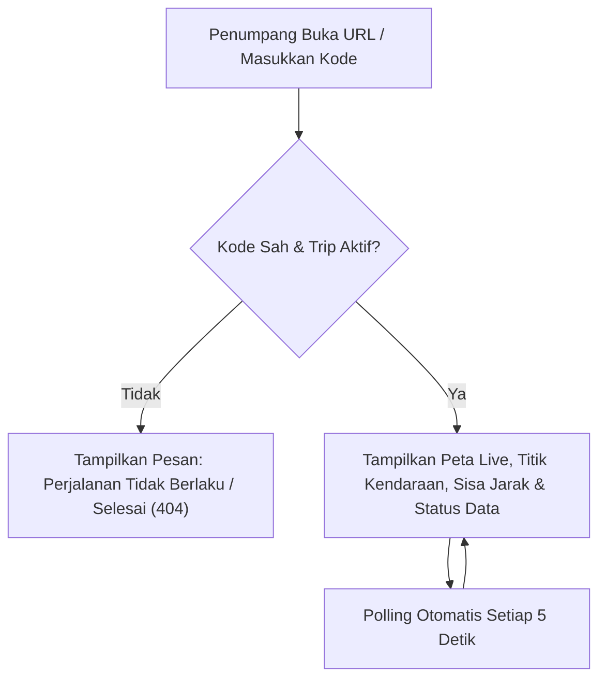

# PM_11 — Alur Pengguna, Rancangan Antarmuka, dan Status Dashboard

**Versi Dokumen:** 1.1 (Revisi Lengkap Selaras Issue #12 & Walkthrough Tim)  
**Tanggal:** 27 November 2026 (Tahap Pelaksanaan M3–M4)  
**PIC Perencanaan & Analisis Sistem:** Maulana Rizki Ramadhani  
**PIC Frontend & UI/UX:** Muhammad Arinal Haq  
**Status Kartu Kanban:** Selesai Disepakati & Siap *Done* (Menjadi Acuan Implementasi PM_12)

---

## 1. Pendahuluan dan Tujuan

Dokumen ini mendefinisikan alur pengguna, tata letak antarmuka responsif (desktop dan perangkat seluler mulai 360 px), pemetaan elemen antarmuka ke endpoint REST API backend, representasi visual status data telemetri, skenario pengujian calon pengguna (UAT), serta penyelarasan desain terhadap Gambar 5.6 proposal proyek **PM-TRAVEL**.

Dokumen ini memenuhi seluruh butir kriteria kartu **PM_11 (Issue #12)** sebagai hasil kolaborasi antara Maulana Rizki Ramadhani dan Muhammad Arinal Haq beserta seluruh anggota tim.

---

## 2. Peran dan Alur Pengguna (*User Flow*)

### 2.1 Penumpang Publik (Tanpa Autentikasi Login)
1. **Membuka Tautan / Memasukkan Kode Perjalanan**: Penumpang mengakses antarmuka melalui tautan yang dibagikan operator (parameter URL `?trip={public_code}`) atau memasukkan kode akses unik 192-bit pada kolom *Lacak Perjalanan* di tab Penumpang.
2. **Memantau Perjalanan Aktif**:
   - Menampilkan posisi kendaraan secara langsung di peta interaktif Leaflet.
   - Menampilkan label waktu pengamatan GPS (`observed_at`) dalam format waktu lokal WIB (UTC+7) beserta usia data (*data age* dalam detik).
   - Menampilkan jarak garis lurus (*straight-line distance*) ke dua target tetap koridor: titik transit antara (**Hajimena**) dan tujuan akhir (**Kotabumi**).
   - Menampilkan indikator status kedatangan di Hajimena serta status estimasi waktu tiba (ETA). ETA ditandai secara jujur sebagai *Belum tersedia (PM_15)* sebelum integrasi model machine learning pada PM_15.
3. **Penanganan Kondisi Perjalanan Selesai/Batal**:
   - Jika perjalanan diselesaikan oleh operator di Kotabumi atau dibatalkan, kode akses publik dicabut oleh backend (HTTP 404).
   - Antarmuka menampilkan pemberitahuan ramah pengguna: *"Perjalanan telah selesai atau kode tidak lagi aktif"*. Penumpang tidak diberikan akses ke riwayat koordinat GPS mentah internal.



---

### 2.2 Operator Travel (Pengguna Terautentikasi)
1. **Autentikasi Sesi**: Operator masuk menggunakan email dan kata sandi pada halaman login (`POST /api/auth/login`). Token JWT (masa berlaku 30 menit) disimpan hanya di memori browser (tidak di `localStorage` demi keamanan akses).
2. **Dashboard Operasional Armada**:
   - Memantau armada di bawah tanggung jawabnya: nomor pelat, pengemudi, status GPS, dan kecepatan.
   - Peta interaktif dapat dipusatkan pada kendaraan yang dipilih (*Center Map*).
   - Menampilkan indikator telemetri (*Floating Pill*) yang menyajikan status lokasi (*fresh*, *stale*, *no_update*), koordinat lintang/bujur, jumlah satelit, dan nilai HDOP.
3. **Manajemen Siklus Hidup Perjalanan (*Trip Lifecycle*)**:
   - **Buat Perjalanan Baru (`POST /api/trips/`)**: Memilih kendaraan untuk membuat trip baru berstatus `planned`. Salinan target rute (Hajimena & Kotabumi) otomatis disimpan ke snapshot trip.
   - **Mulai Perjalanan (`POST /api/trips/{id}/start`)**: Mengubah status perjalanan dari `planned` menjadi `active`. Sistem menghasilkan `public_code` 192-bit yang ditampilkan dalam modal untuk disalin operator.
   - **Catat Tiba di Hajimena (`POST /api/trips/{id}/arrive-hajimena`)**: Mencatat timestamp tiba di agen transit Hajimena. Perjalanan tetap aktif menuju Kotabumi.
   - **Selesaikan Perjalanan (`POST /api/trips/{id}/complete`)**: Menyelesaikan perjalanan di Kotabumi. Status berubah menjadi `completed` dan hak akses kode publik penumpang dicabut.
   - **Batalkan Perjalanan (`POST /api/trips/{id}/cancel`)**: Membatalkan perjalanan terjadwal atau aktif jika terjadi kendala operasional.
   - **Pemeriksaan Riwayat & Jarak**: Membuka modal detail trip untuk meninjau akumulasi jarak segmen GPS (*traveled GPS distance*) dan tabel riwayat posisi koordinat valid (maksimal 50–200 baris).

---

### 2.3 Administrator Teknis
- Memiliki seluruh kewenangan operator ditambah konfigurasi master armada: registrasi kendaraan baru (`POST /api/vehicles/`), penugasan operator kendaraan (`PATCH /api/vehicles/{id}`), pendaftaran modul GPS IoT (`POST /api/devices/`), serta pembaruan koordinat rute (`PUT /api/route-targets/{seq}`).
- Tidak memerlukan dashboard pengelolaan versi model machine learning yang rumit; pemeriksaan teknis cukup dilakukan melalui endpoint health check (`/health`, `/health/db`) dan log sistem.

---

## 3. Tata Letak dan Wireframe Antarmuka Responsif

Desain antarmuka dibuat responsif mulai dari layar ponsel pintar dengan lebar 360 px hingga monitor desktop beresolusi 1680 px:

### 3.1 Tata Letak Desktop (Lebar Layar $\ge$ 1000 px)
```
+----------------------------------------------------------------------------------------------------+
| [Logo PM-TRAVEL]  Koridor Lampung   |   Status: Terhubung (5s)   | [User: operator@travel] [Keluar]|
+-------------------------------------+--------------------------------------------------------------+
| NAVIGASI SIDEBAR    | AREA KERJA UTAMA                                                             |
| - Ringkasan         | +---------------+ +---------------+ +---------------+ +--------------------+ |
| - Pemantauan Peta   | | Total Armada  | | Trip Aktif    | | GPS Segar     | | Rata-rata Speed    | |
| - Kelola Perjalanan | |     1 Unit    | |     1 Aktif   | |    100%       | |     45 km/jam      | |
| - Riwayat Operasi   | +---------------+ +---------------+ +---------------+ +--------------------+ |
| - Pengaturan Sistem |                                                                              |
|                     | +-----------------------------------------------------+ +------------------+ |
| [Mini Map Koridor]  | | PETA INTERAKTIF LIVE (Leaflet / Google Maps)        | | DAFTAR KENDARAAN | |
| Tanjung Karang      | |                                                     | | [PMT-001] BE1234 | |
|   | (Transit)       | |   [ Floating Telemetry Pill: 48 km/jam | Segar 4s ] | | Driver: Budi     | |
| Hajimena            | |                                                     | | Status: Aktif    | |
|   | (Tujuan)        | |      (Marker Mobil) ----> (Rute Polylines)          | | Lokasi: Hajimena | |
| Kotabumi            | |                                                     | | [Center Map]     | |
|                     | +-----------------------------------------------------+ +------------------+ |
+---------------------+------------------------------------------------------------------------------+
```

### 3.2 Tata Letak Seluler / Mobile (Lebar Layar 360 px – 768 px)
```
+------------------------------------------+
| [=] PM-TRAVEL             [Badge: Online]|
+------------------------------------------+
| TAB SELEKSI: [ Penumpang ] [ Operator ]  |
+------------------------------------------+
| PETA PELACAKAN PENUMPANG (Tinggi: 320px) |
| +--------------------------------------+ |
| | [Pill: BE 1234 QA | 52 km/jam | Segar]| |
| |                                      | |
| |      (Marker Mobil)                  | |
| |         |                            | |
| |         v (Garis Koridor)            | |
| |      [Hajimena]                      | |
| +--------------------------------------+ |
| ESTIMASI & TARGET PERJALANAN             |
| - Menuju Hajimena : 4,2 km (Sisa Jarak)  |
|   ETA             : Belum tersedia (PM15)|
| - Menuju Kotabumi : 68,5 km              |
|   ETA             : Belum tersedia (PM15)|
| STATUS TELEMETRI                         |
| - Waktu Update : 14:32:10 WIB (4 dtk lalu|
| - Sinyal GPS   : Valid (8 Satelit)       |
+------------------------------------------+
| BOTTOM TAB BAR (Navigasi Jempol Cepat)   |
| [Peta]   [Perjalanan]   [Riwayat] [Akun] |
+------------------------------------------+
```

---

## 4. Matriks Pemetaan Elemen Antarmuka ke Endpoint REST API

| Komponen Antarmuka | Elemen Data yang Ditampilkan | Endpoint API Backend | Metode | Hak Akses |
|---|---|---|:---:|---|
| Formulir Login | Email, Kata Sandi, Token JWT | `/api/auth/login` | POST | Publik |
| Header / Bar Atas | Email operator, peran (*role*) | `/api/auth/me` | GET | Operator/Admin |
| Daftar Kendaraan | ID armada, nomor pelat, status penugasan | `/api/vehicles/` | GET | Operator/Admin |
| Peta & Marker Live | Lintang, bujur, kecepatan, usia data, validitas GPS | `/api/vehicles/{id}/location/latest` | GET | Operator/Admin |
| Target Koridor | Urutan transit, nama target, koordinat referensi | `/api/route-targets/` | GET | Operator/Admin |
| Daftar Perjalanan | ID trip, kendaraan, status (`planned`/`active`/dll) | `/api/trips/` | GET | Operator/Admin |
| Formulir Buat Trip | Pemilihan kendaraan aktif | `/api/trips/` | POST | Operator/Admin |
| Aksi Mulai Trip | Mengubah ke status aktif & menerbitkan `public_code` | `/api/trips/{id}/start` | POST | Operator/Admin |
| Aksi Tiba Hajimena | Timestamp tiba transit di Hajimena | `/api/trips/{id}/arrive-hajimena` | POST | Operator/Admin |
| Aksi Selesai Trip | Menyelesaikan perjalanan di Kotabumi | `/api/trips/{id}/complete` | POST | Operator/Admin |
| Aksi Batalkan Trip | Pembatalan perjalanan terjadwal/aktif | `/api/trips/{id}/cancel` | POST | Operator/Admin |
| Detail & Riwayat Trip | Akumulasi jarak segmen GPS, snapshot target | `/api/trips/{id}` | GET | Operator/Admin |
| Riwayat Titik GPS | Log koordinat breadcrumb jejak perjalanan | `/api/trips/{id}/positions` | GET | Operator/Admin |
| Pelacakan Penumpang | Posisi mobil live, sisa jarak dua target, status data | `/api/public/trips/{code}` | GET | Publik (Via Kode) |

---

## 5. Definisi Status Data dan Penanganan Kondisi Khusus

Status data telemetri tidak hanya disajikan melalui warna, tetapi selalu disertai **label teks eksplisit** dan satuan baku:
- **Format Waktu**: Format ISO-8601 UTC pada penyimpanan/API, ditampilkan dalam zona waktu lokal **WIB (UTC+7)** pada antarmuka.
- **Satuan**: Kecepatan dalam **km/jam**, jarak dalam **kilometer (km)** atau **meter (m)** jika jarak $<1$ km, usia data dalam **detik**.

| Status Telemetri | Kriteria Ambang Waktu | Warna Indikator | Teks Status UI | Penanganan Antarmuka |
|---|---|---|---|---|
| **GPS Segar (*Fresh*)** | Usia data $\le 30$ detik sejak `observed_at` | Hijau Mint (`#427345` / `#22c55e`) | **GPS Segar** | Marker kendaraan bergerak aktif dengan interpolasi animasi GSAP |
| **GPS Terlambat (*Stale*)** | Usia data $> 30$ detik s.d. $60$ detik | Kuning Amber (`#9b7424` / `#f59e0b`) | **GPS Terlambat** | Menampilkan tanda peringatan bahwa update GPS mengalami perlambatan jaringan seluler |
| **Tidak Ada Pembaruan (*No Update*)** | Usia data $> 60$ detik sejak pengamatan | Merah Rose (`#a05b4c` / `#ef4444`) | **Tidak Ada Pembaruan** | Marker kendaraan diberi filter redup, memperingatkan operator bahwa transmisi GPS terhenti |
| **Belum Ada Lokasi** | Koordinat `null` / GPS belum fix | Abu-abu Netral (`#7d897f`) | **Belum Ada Sinyal** | Peta menampilkan posisi awal agen terminal Tanjung Karang dengan status menanti fix satelit |
| **Gagal Koneksi API** | HTTP 5xx / Network Error saat polling | Merah / Banner Notifikasi | **Koneksi Server Terputus** | Sistem menampilkan banner offline di atas peta dan mencoba koneksi ulang berkala (*retry backoff*) |
| **Status ETA (PM_15)** | Sebelum integrasi model ML (PM_15) | Abu-abu / Netral | **Belum tersedia (PM_15)** | Menolak keras menampilkan estimasi rekaan/palsu; mencantumkan sisa jarak garis lurus aktual |

---

## 6. Keputusan Desain Visual vs Kebutuhan Fungsi Proposal

Berdasarkan diskusi penyelarasan antara Maulana Rizki Ramadhani (PM/Analyst) dan Muhammad Arinal Haq (Frontend):
1. **Pemisahan Keputusan Visual dari Fungsi Proposal**:
   - Proposal awal memuat wireframe monokrom statis sederhana. Antarmuka disepakati menggunakan tema modern bernuansa hijau eksekutif travel (`#427345`) dipadukan dengan aksen gelap (*slate/dark-light adaptive*) untuk kenyamanan mata operator yang memantau berjam-jam.
   - Menggunakan *Floating Telemetry Pill* dengan efek *glassmorphism* di atas peta agar informasi vital (kecepatan, satelit, usia GPS) dapat dibaca tanpa menutupi area pandang rute.
   - Peta menggunakan integrasi *Leaflet* (OpenStreetMap) dengan opsi *toggle* Google Maps tile layer, dilengkapi interpolasi pergerakan titik halus (*smooth tweening*) menggunakan GSAP.
2. **Kesesuaian dengan Kebutuhan Fungsi**:
   - Seluruh batasan fungsi proposal (satu kendaraan uji, koridor Tanjung Karang $\to$ Hajimena $\to$ Kotabumi, pemisahan hak akses publik vs operator) dipertahankan 100% tanpa kompromi.

---

## 7. Notulen Walkthrough Tim dan Skenario Tugas UAT Calon Pengguna

Pada sesi *walkthrough* internal tim yang dihadiri seluruh anggota, disepakati 5 skenario tugas yang akan diujikan kepada 1 calon pengguna pada tahap UAT mendatang:

| No Tugas | Peran Penguji | Skenario Tindakan Calon Pengguna | Kriteria Keberhasilan Tugas |
|:---:|---|---|---|
| **T-01** | Penumpang | Membuka tautan dengan kode perjalanan aktif yang diberikan operator. | Halaman pelacakan terbuka langsung, peta memusatkan kendaraan, dan sisa jarak ke Hajimena & Kotabumi tampil tanpa error. |
| **T-02** | Penumpang | Membaca status lokasi dan kondisi keterlambatan data. | Calon pengguna mampu mengidentifikasi status data (apakah *Segar* atau *Terlambat*) dan membaca waktu update dalam WIB. |
| **T-03** | Operator | Melakukan login menggunakan akun operator yang sah. | Berhasil masuk ke dashboard operator dalam waktu $<3$ detik dan melihat daftar armada. |
| **T-04** | Operator | Melakukan inisiasi perjalanan baru (*Create & Start Trip*). | Perjalanan baru terbit, status berubah dari `planned` menjadi `active`, dan kode publik berhasil disalin. |
| **T-05** | Operator | Memeriksa riwayat perjalanan dan akumulasi jarak GPS. | Modal riwayat trip terbuka, menampilkan total jarak tempuh (*traveled GPS distance*) dan tabel koordinat breadcrumb. |

*Catatan Evaluasi*: Keberhasilan penyelesaian tugas tanpa bantuan dan skor kuesioner SUS (*System Usability Scale*) akan dicatat sebagai evaluasi kegunaan individual calon pengguna.

---

## 8. Penyelarasan Gambar 5.6 Proposal dan Versi Acuan PM_12

- **Status Gambar 5.6 Proposal**: Wireframe awal pada Gambar 5.6 proposal proyek mandiri telah direvisi dan diselaraskan secara penuh menjadi tata letak antarmuka modern responsif sebagaimana didokumentasikan pada Bagian 3 dokumen ini.
- **Versi Desain Acuan**: Versi desain **v1.1** pada dokumen ini disepakati menjadi **acuan resmi tunggal (*Single Source of Truth*)** bagi implementasi antarmuka pada kartu **PM_12**.
- Seluruh 10 butir checklist pada **Issue #12 (PM_11)** telah dipenuhi secara menyeluruh.
